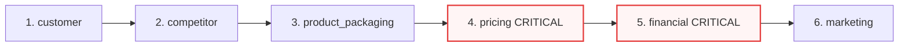
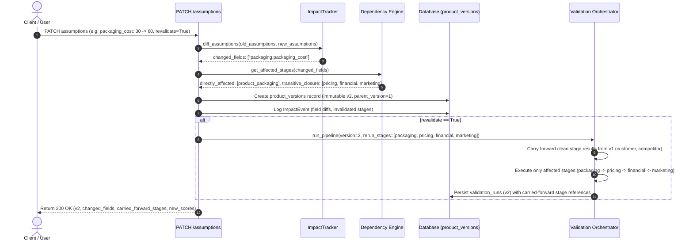
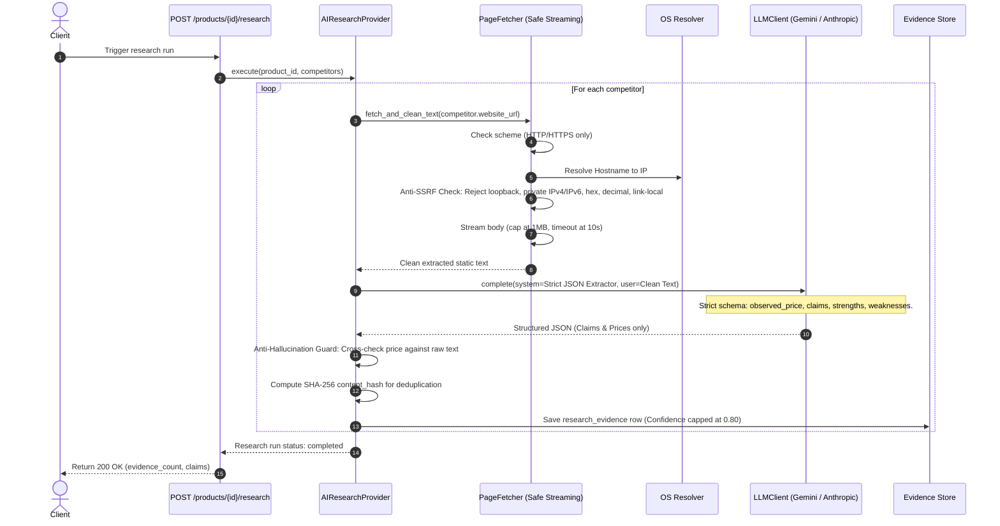

# LaunchTwin AI — System Architecture & Design Specification

This document details the architectural boundaries, deterministic pipeline sequencing, dependency invalidation graphs, safe AI research boundaries, and precision arithmetic rules governing LaunchTwin AI.

---

## 1. Architectural Layers & Boundaries

LaunchTwin enforces a strict separation between I/O layers (HTTP, ORM, AI, network) and the deterministic core:

```mermaid
graph TD
    subgraph Layer 1: Client & External
        WEB[Vite / React Client]
        HTTP_IN[External Ingestion Webhooks]
        WWW[Target Competitor Websites]
        LLM_EXT[Gemini / Anthropic REST APIs]
    end

    subgraph Layer 2: API & Transport app/api/v1
        ROUTER[FastAPI Routers: Products, Competitors, Validation, Simulation, Reports]
        MIDDLEWARE[Error Envelopes, Request ID, CORS]
    end

    subgraph Layer 3: Persistence app/models & core/database
        ORM[SQLAlchemy 2.0 Models: Product, Version, ValidationRun, Evidence, ImpactEvent]
        DB[(PostgreSQL 16 / SQLite)]
    end

    subgraph Layer 4: AI & Research Services app/services
        RP[ResearchProvider Protocol]
        MRP[MockResearchProvider]
        ARP[AIResearchProvider]
        PF[PageFetcher: SSRF Guarded & Streaming]
        LLMC[LLMClient: GeminiRESTClient / AnthropicRESTClient]
    end

    subgraph Layer 5: Pure Deterministic Engines ZERO I/O, ZERO Float
        VO[Validation Orchestrator]
        STAGES[6 Sequential Stages: Customer, Competitor, Packaging, Pricing, Financial, Marketing]
        FIN[Finance Engine: Decimal Math]
        DEP[Dependency Engine: Stage Invalidation DAG]
        READ[Readiness Scoring Engine]
        REC[Recommendation Generator]
        SIM[What-If Simulation Engine]
        IMP[Impact Tracker: JSON Patch & Stage Diffing]
    end

    WEB --> ROUTER
    HTTP_IN --> ROUTER
    ROUTER --> ORM
    ORM --> DB
    
    ROUTER --> RP
    RP --> MRP
    RP --> ARP
    ARP --> PF
    ARP --> LLMC
    PF --> WWW
    LLMC --> LLM_EXT
    ARP -.->|Persist Evidence Rows| ORM

    ROUTER --> VO
    ROUTER --> SIM
    VO --> FIN
    VO --> STAGES
    VO --> DEP
    VO --> READ
    VO --> REC
    ROUTER --> IMP
    IMP --> DEP
```

### Pure Layer Invariant Rule
The pure domain modules (`finance.py`, `dependencies.py`, `impact_tracker.py`, `readiness.py`, `recommendations/`, `stages/`, `simulation.py`, `orchestrator.py`) **import nothing** from:
- `sqlalchemy` or ORM models
- `httpx` or network clients
- `openai`, `anthropic`, or LLM clients
- `app.models` or `app.api`
- Python `float` (all arithmetic uses `decimal.Decimal`)

---

## 2. Stage Dependency Graph & Execution Order

The sequential validation pipeline evaluates 6 business stages in topological order:



### Critical Stages
- **`pricing`**: Validates target margin compliance and asserts that the product price falls within competitive market price corridors.
- **`financial`**: Validates unit economics, variable cost ceilings, positive contribution margin, and break-even unit feasibility.
- **Rule**: If *any* critical stage status is `FAILED`, the overall product readiness verdict is capped at `NOT_READY`, regardless of other stage scores.

---

## 3. Assumption Patching & Selective Revalidation Flow

When product assumptions change, LaunchTwin generates a new immutable version and re-evaluates only downstream affected stages:



---

## 4. Market Research Engine, Anti-SSRF, and Anti-Hallucination

The market research subsystem gathers competitive intelligence without allowing untrusted web data or LLMs to alter financial calculations or stage verdicts:



### Security & Hallucination Guardrails
1. **Network Boundary**: AI and HTTP network access are isolated to `services/page_fetcher.py` and `services/llm_client.py`. All other modules operate offline.
2. **Anti-SSRF Enforcement**:
   - Rejects loopback addresses (`127.0.0.0/8`, `::1`).
   - Rejects IPv6-mapped IPv4 addresses (e.g. `::ffff:127.0.0.1`).
   - Rejects decimal and hex IP representations (e.g. `http://2130706433`, `http://0x7f000001`).
   - Rejects RFC 1918 private ranges (`10.0.0.0/8`, `172.16.0.0/12`, `192.168.0.0/16`).
   - Follows redirects manually up to 3 hops, verifying destination IP after each redirect before requesting the next hop.
3. **Anti-Hallucination Constraints**:
   - LLMs are restricted to returning JSON with `observed_price`, `claims`, `strengths`, and `weaknesses`.
   - AI outputs are stored exclusively as `research_evidence` rows.
   - AI confidence is strictly capped at `0.80` (manual entries receive `1.00`).
   - The validation pipeline reads evidence rows to evaluate competitive coverage, but Python formulas calculate all price differences, margins, and thresholds.

---

## 5. Rounding Rules & Precision Standards

All calculations follow strict precision rules to guarantee deterministic parity between local and production environments:

| Metric Type | Representation | Rounding Mode | Precision Rule | Code Example |
| :--- | :--- | :--- | :--- | :--- |
| **Monetary Amounts** | `Decimal` / `String` | `ROUND_HALF_UP` | Exactly 2 decimal places (`0.01`) | `price.quantize(Decimal("0.01"), rounding=ROUND_HALF_UP)` |
| **Ratios / Margins / Rates** | `Decimal` / `Float` | `ROUND_HALF_UP` | Exactly 4 decimal places (`0.0001`) | `margin.quantize(Decimal("0.0001"), rounding=ROUND_HALF_UP)` |
| **Readiness Scores** | `Decimal` / `String` | `ROUND_HALF_UP` | Exactly 2 decimal places (`0.01`), range `0.00` to `100.00` | `score.quantize(Decimal("0.01"), rounding=ROUND_HALF_UP)` |
| **Break-Even Units** | `Integer` | Ceiling | Smallest integer `>= Fixed Costs / Contribution` | `int(math.ceil(fixed_costs / contribution))` |
| **Confidence Scores** | `Decimal` | `ROUND_HALF_UP` | 2 decimal places, range `0.00` to `1.00` | `Decimal("0.80")` |

---

## 6. Centralized Business Thresholds

All thresholds, scoring weights, and stage boundaries reside in a single configuration file:
👉 [`backend/app/services/validation/rules_config.py`](file:///c:/Users/huzef/OneDrive/Desktop/d2c-platform/backend/app/services/validation/rules_config.py)

Key thresholds defined in `rules_config.py`:
- `MIN_CUSTOMER_INTERVIEWS`: 10 (Stage: `customer`)
- `MIN_COMPETITORS_REQUIRED`: 2 (Stage: `competitor`)
- `MAX_PACKAGING_COST_RATIO`: 0.15 (15% of selling price; Stage: `product_packaging`)
- `MIN_CONTRIBUTION_MARGIN`: 0.20 (20% minimum margin threshold; Stage: `pricing` and `financial`)
- `MAX_CAC_TO_CONTRIBUTION_RATIO`: 0.50 (50% max CAC relative to unit contribution; Stage: `marketing`)
- `STAGE_WEIGHTS`:
  - `customer`: 15%
  - `competitor`: 15%
  - `product_packaging`: 10%
  - `pricing`: 20%
  - `financial`: 25%
  - `marketing`: 15%
  - *Total = 100%*
